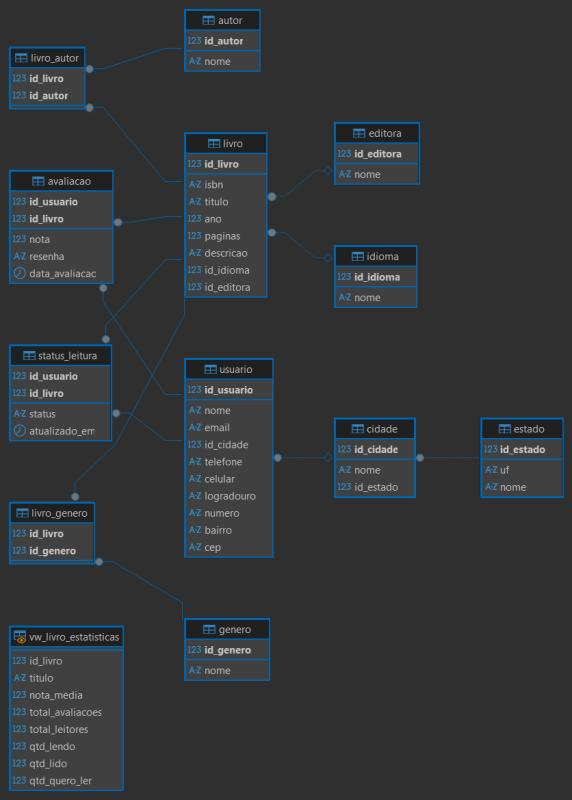

# Sistema de Banco de Dados · Catálogo de Livros e Cadastro de Usuários

Projeto da disciplina de Banco de Dados · Ciência de Dados e IA · PUC-SP (jan–jun 2026).

Sistema de banco de dados relacional para organizar, armazenar e recuperar as informações de uma **comunidade de leitores**. Mantém um cadastro de usuários, com endereço completo, e um catálogo de livros com autores, gêneros, editoras, idiomas, avaliações e o status de leitura de cada usuário.

## Demonstração online

👉 **[Abrir a prévia do catálogo](https://joaocoelho77.github.io/sgbd-catalogo-livros/)**: consulta de livros e cadastro de leitores, rodando no navegador com uma amostra dos dados.

## Modelo entidade-relacionamento



| Grupo | Tabelas |
|---|---|
| Catálogo | `livro`, `autor`, `livro_autor`, `genero`, `livro_genero`, `editora`, `idioma` |
| Usuários | `usuario`, `cidade`, `estado` |
| Interação | `avaliacao`, `status_leitura` |
| Visão | `vw_livro_estatisticas` (nota média, total de avaliações e leitores, quantidade lendo, lido e quero ler) |

## Estrutura

```
sql/       scripts de criação, carga e consultas
docs/      documentação completa (PDF)
imagens/   imagens do README
index.html prévia web publicada no GitHub Pages
```

## Ferramentas

SQL · Modelagem de dados · Entrada de dados

## Equipe

João Pedro Coelho, Kaique Munhoz, Théo Seraphim e Yuri Nicolav · Professor: Renan Trevisoli Doria
